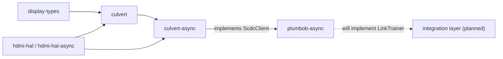

# culvert-async

[](https://github.com/DracoWhitefire/culvert-async/actions/workflows/ci.yml)
[](https://crates.io/crates/culvert-async)
[](https://docs.rs/culvert-async)
[](LICENSE)
[](https://blog.rust-lang.org/2025/02/20/Rust-1.85.0.html)
[](https://slsa.dev)

Async typed access to the HDMI 2.1 SCDC register map.

`culvert-async` is the async companion to [`culvert`]: culvert's `Scdc` client with
`async fn` methods over an [`hdmi_hal_async::scdc::ScdcTransport`]. The register map is
culvert's — every address, bit and protocol check comes from `culvert::codec`, and
culvert-async only performs the reads and writes — so the sync and async clients always
agree. All register types and error types are re-exported from `culvert` so callers do not
need both crates.

## Usage

```sh
cargo add culvert-async
```

Wrap your async transport in `Scdc` and await typed methods:

```rust
use culvert_async::{ClearableUpdateFlags, FfeLevels, FrlConfig, FrlRate, Scdc, TmdsConfig};

let mut scdc = Scdc::new(transport);

// Version negotiation
let sink_ver = scdc.read_sink_version().await?;
scdc.write_source_version(1).await?;

// Enable TMDS scrambling
scdc.write_tmds_config(TmdsConfig {
    scrambling_enable: true,
    high_tmds_clock_ratio: true,
}).await?;

// Wait for the sink to be ready, then request an FRL rate
let flags = scdc.read_status_flags().await?;
if flags.flt_ready {
    scdc.write_frl_config(FrlConfig::new(
        FrlRate::Rate12Gbps4Lanes,
        FfeLevels::new(3).unwrap(),
    )).await?;
}

// On FLT_Update, read the pattern each lane requests, then acknowledge the flag
let updates = scdc.read_update_flags().await?;
if updates.flt_update {
    let requests = scdc.read_ltp_requests().await?;
    scdc.clear_update_flags(ClearableUpdateFlags::new(false, false, false, false, true, false)).await?;
    if requests.all_trained() {
        // training passed; wait for FRL_Start in the update flags
    }
}

// Read per-lane character error counts
let ced = scdc.read_ced().await?;
if let Some(count) = ced.lane0 {
    // lane 0 has a valid error count
}
```

To use `culvert-async` as the SCDC backend for `plumbob-async`'s link training state
machine, enable the `plumbob-async` feature:

```sh
cargo add culvert-async --features plumbob-async
cargo add plumbob-async
```

`Scdc<T>` then implements `plumbob_async::ScdcClient` automatically.

To spawn training on a multi-threaded executor, use a transport that implements
hdmi-hal-async's `SendScdcTransport` and a PHY that implements `SendHdmiPhy`: training
through `Scdc<T>` is then `Send`, also in code generic over the transport and the PHY
(bound them by the twins alone). Code bounded by plumbob-async's `SendScdcClient` needs a
small wrapper; see [`doc/architecture.md`](doc/architecture.md) ("`Send` futures").

## Register coverage

| Register group            | Addresses   | Methods |
|---------------------------|-------------|---------|
| Version                   | 0x01–0x02   | `read_sink_version`, `write_source_version` |
| Update flags              | 0x10        | `read_update_flags`, `clear_update_flags` |
| TMDS / scrambling         | 0x20–0x21   | `write_tmds_config`, `read_scrambler_status` |
| FRL config                | 0x30–0x31   | `write_config_0`, `write_frl_config` |
| Source test configuration | 0x35        | `read_source_test_config` |
| Status flags              | 0x40        | `read_status_flags` |
| LTP requests              | 0x41–0x42   | `read_ltp_requests` |
| Character Error Detection | 0x50–0x55, 0x57–0x58 | `read_ced` |
| RS correction count       | 0x59–0x5A   | `read_rs_correction` |

The register map is culvert's (`culvert::codec`); its sources are described in culvert's
architecture document, and registers not yet covered in culvert's roadmap.

## Features

| Feature         | Default | Description                                          |
|-----------------|---------|------------------------------------------------------|
| `plumbob-async` | no      | Implements `plumbob_async::ScdcClient` for `Scdc<T>` |

## `no_std`

`culvert-async` is `#![no_std]` throughout. All output types are stack-allocated; no
allocator is required in any configuration.

## Stack position



`culvert-async` does not depend on `plumbob-async`. The relationship runs the other way:
enabling the `plumbob-async` feature makes `Scdc<T>` implement
`plumbob_async::ScdcClient`. Any crate that implements `ScdcClient` is substitutable.

## Out of scope

- **Sync API** — callers on sync transports use [`culvert`] directly.
- **Link training state machine** — the sequencing of FRL training belongs in
  `plumbob-async`. `culvert-async` provides the register operations; the state machine
  decides when to call them.
- **PHY configuration** — `HdmiPhy` operations are the link training layer's concern.
- **I²C / DDC transport** — platform backends implement
  `hdmi_hal_async::scdc::ScdcTransport`. `culvert-async` never touches I²C directly.

## Documentation

- [`doc/setup.md`](doc/setup.md) — build, test, coverage, and example commands
- [`doc/architecture.md`](doc/architecture.md) — role, scope, the client, the `plumbob-async`
  feature, and design principles
- [`doc/testing.md`](doc/testing.md) — testing strategy, transport harness, and CI expectations
- [`doc/roadmap.md`](doc/roadmap.md) — deferred register groups and planned API surfaces

## Verifying releases

Each release is built on GitHub Actions and attested with
[SLSA Build Level 2](https://slsa.dev) provenance. To verify a release
`.crate` against its signed provenance, install the
[GitHub CLI](https://cli.github.com/) and run:

```sh
gh attestation verify culvert-async-X.Y.Z.crate --repo DracoWhitefire/culvert-async
```

The attested `.crate` is attached to each
[GitHub release](https://github.com/DracoWhitefire/culvert-async/releases).

## License

Licensed under the [Mozilla Public License 2.0](LICENSE).
